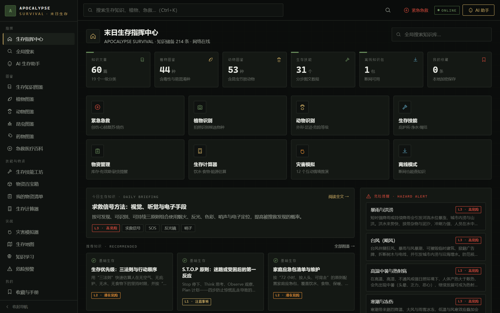
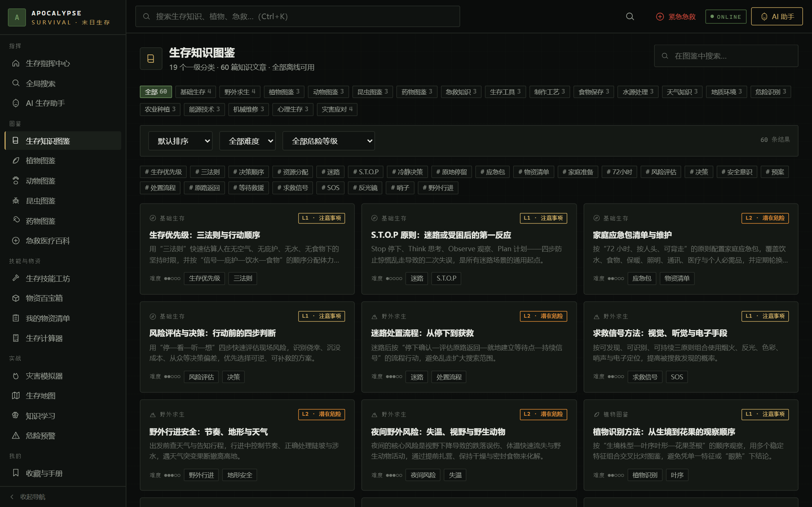
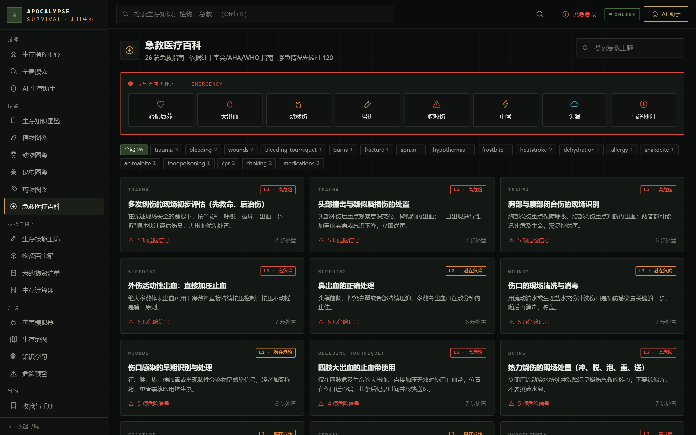
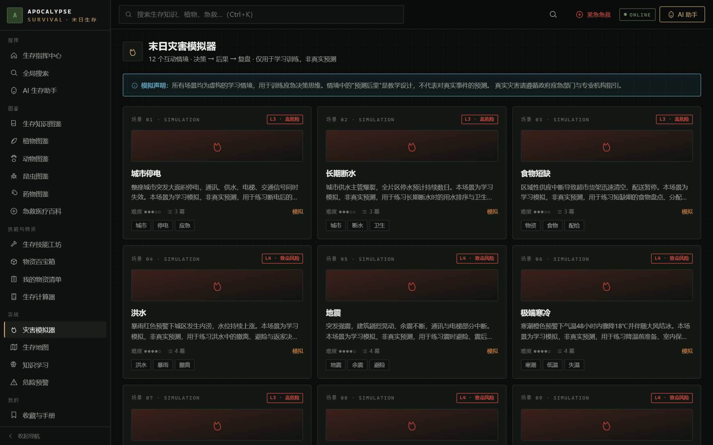
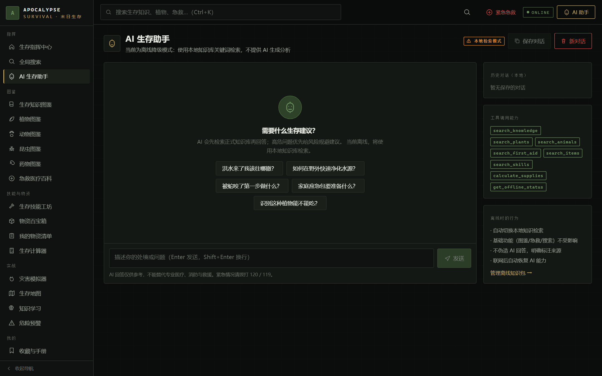
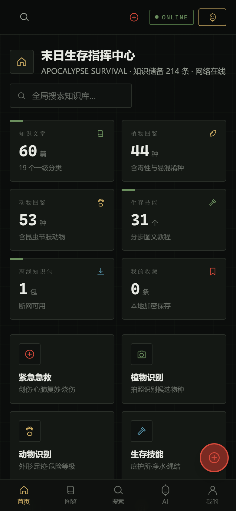
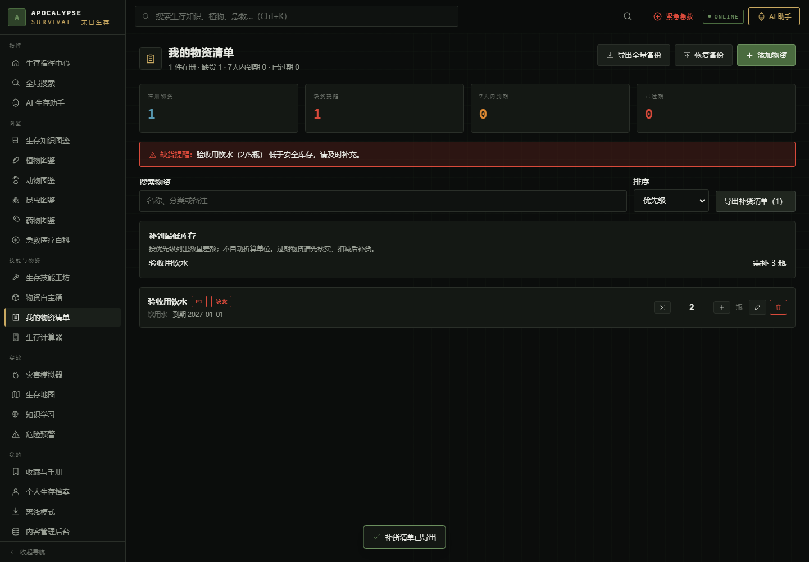

# APOCALYPSE SURVIVAL · 末日生存指南

## 最新更新

### v1.1.1 · 2026-11-13

- 同时提供网页版、Windows x64 安装程序和 Android APK，三端使用相同版本的知识与物资管理功能。
- Windows 和 Android 可通过系统保存窗口导出备份、收藏与补货 CSV；取消保存不会误报成功，写入失败会明确提示。
- 原生应用内置离线资源，设置页明确显示安装包版本和覆盖安装的更新方式。

[完整更新历史](docs/releases/release-notes.md) · [三端下载 v1.1.1](https://github.com/yuchen0x1/Doomsday-Survival-Guide/releases/tag/v1.1.1) · [在线使用](https://yuchen0x1.github.io/Doomsday-Survival-Guide/)

| 使用方式          | 入口 / 文件                                                                                                                                    |
| ----------------- | ---------------------------------------------------------------------------------------------------------------------------------------------- |
| 网页版 / PWA      | [直接打开](https://yuchen0x1.github.io/Doomsday-Survival-Guide/)，支持浏览器「安装应用」；自行托管下载 `apocalypse-survival-web-v1.1.1.tar.gz` |
| Windows 10/11 x64 | `apocalypse-survival-windows-x64-v1.1.1-setup.exe`，包含 WebView2 离线安装组件                                                                 |
| Android           | `apocalypse-survival-android-v1.1.1.apk`，正式发布密钥签名                                                                                     |

安装说明、校验方法及测试范围见 [三端发布说明](docs/releases/v1.1.1-platforms.md)。Windows 安装程序未做 Authenticode 签名，可能显示系统安全提示。个人数据分别保存在各设备中，可通过 JSON 备份手动迁移；更新前建议备份，不要通过卸载来升级。

**一份可离线运行、跨平台的末日生存百科全书。** 全部知识随应用打包，断网照样能查；AI 只做辅助，绝不替代审核结论。

[](https://yuchen0x1.github.io/Doomsday-Survival-Guide/)
[](LICENSE)
[](apps/web)
[](tsconfig.base.json)
[](apps/web/vite.config.ts)
[](apps/web/vite.config.ts)
[](apps/desktop)
[](apps/api)

**[🔗 在线 Demo](https://yuchen0x1.github.io/Doomsday-Survival-Guide/)** · **[📖 断网离线生存手册](docs/OFFLINE_SURVIVAL_MANUAL.html)** · [文档索引](#文档索引) · [快速开始](#快速开始)

> Demo 为 GitHub Pages 静态托管，**不启动后端**：全部图鉴、急救、技能、计算器、模拟器可直接使用，AI 助手会自动进入「本地检索模式」。部署提供 SPA 回退。历史 WorkBuddy Demo 不会随 GitHub 发布自动同步。



---

## 项目简介

APOCALYPSE SURVIVAL 是一套「离线优先」的生存知识系统，覆盖 Web、Windows 桌面（Tauri 2）与移动（Capacitor 6）三端，并附带一套 NestJS + Prisma + PostgreSQL 后端，用于内容审核、多用户同步与 AI 代理。

核心设计原则：

- **离线优先**：全部知识数据编译进前端 bundle，由 Service Worker / Workbox 预缓存；个人数据存 IndexedDB，断网不丢失。
- **审核规则优先于人工标注**：危险等级（L0–L4）由 `packages/core` 的审核规则 `computeRequiredDanger` 判定；`packages/knowledge-data` 在加载时通过 `normalize.ts` 按规则**强制提升**危险等级（规则优先、只升不降）。
- **来源可追溯**：每条内容带 `ContentMeta`（审核状态机、可信度 A–D、来源列表）；AI 生成内容默认 `pending_review`，不得直接发布。
- **不伪造 AI 输出**：无 `AI_API_KEY` 或离线时，前端降级为本地知识检索并**明确标注来源**，绝不以 AI 口吻编造结论。

### 数据集实测规模（`scripts/count-entries.cjs`）

| 数据集             | 条目数 | 数据集                | 条目数 |
| ------------------ | -----: | --------------------- | -----: |
| plants 植物        |     44 | articles 知识文章     |     60 |
| skills 生存技能    |     31 | supplies 物资         |     65 |
| animals 动物       |     36 | animalTracks 动物足迹 |     29 |
| firstAid 急救      |     26 | medicines 药物        |     17 |
| scenarios 灾害场景 |     12 | hazards 危险预警      |     40 |
| insects 昆虫       |     17 | quizzes 练习题        |     60 |

---

## 界面预览

> 以下截图均取自真实运行的应用，非设计稿或模型图。图片位于 `docs/assets/screenshots/`。

**知识图鉴**：19 个一级分类、60 篇文章，支持难度与危险等级筛选、标签过滤。



**急救医疗百科**：26 篇指南，按「创伤 / 心肺复苏 / 中毒」等场景组织，每篇标注来源。



**灾害模拟器**：12 个情境推演，决策树 + 复盘，界面明确标注「教学推演，非真实预测」。



**AI 助手（后端未启动时的真实降级）**：不编造回答，明确标注「本地检索模式」，只返回知识库检索结果。



**移动端 / PWA**：390×844 视口，底部导航、双列卡片、安全区适配。



> 桌面端（Tauri 2）与移动端原生容器（Capacitor 6）复用同一套 Web 资产，界面与上表一致；托盘菜单与原生安全区属于宿主能力，未单独截图。

---

## 16 大模块清单

以下为面向用户的核心功能模块，均可在 Web / 桌面 / 移动三端通过同一套路由访问（路由级 lazy 加载，共 38 条）。

|   # | 模块                | 主要路由                                     | 内容与能力                                                |
| --: | ------------------- | -------------------------------------------- | --------------------------------------------------------- |
|   1 | 生存指挥中心        | `/`                                          | 真实数据统计卡片、快捷入口、今日知识、危险提醒、系统状态  |
|   2 | 全局搜索            | `/search`                                    | 自研中文 bigram `SearchIndex`，分类筛选、相关性排序       |
|   3 | AI 生存助手         | `/ai`                                        | SSE 流式对话（服务端持有密钥）+ 离线本地检索降级          |
|   4 | 生存知识图鉴        | `/knowledge`、`/article/:id`                 | 60 篇文章、19 个一级分类、分步图文                        |
|   5 | 植物图鉴与识别      | `/plants`、`/plants/identify`、`/plants/:id` | 44 种植物，毒性/易混淆种，10 步拍照识别流程               |
|   6 | 动物图鉴            | `/animals`、`/animals/:id`                   | 36 种动物 + 29 条足迹，危险等级与咬伤急救                 |
|   7 | 昆虫图鉴            | `/insects`、`/insects/:id`                   | 17 种昆虫/节肢动物，蛰咬风险与处理                        |
|   8 | 药物图鉴            | `/medicines`、`/medicines/:id`               | 17 种药物通用说明、禁忌与免责声明                         |
|   9 | 急救医疗百科        | `/first-aid`、`/first-aid/:id`               | 26 篇急救指南，权威来源溯源                               |
|  10 | 生存技能工坊        | `/skills`、`/skills/:id`                     | 31 个分步教程、安全清单、失败原因                         |
|  11 | 物资百宝箱          | `/supplies`、`/supplies/:id`                 | 65 项物资用途、储存、保质期、替代品                       |
|  12 | 我的物资清单        | `/inventory`                                 | 库存、有效期、缺货提醒、消耗流水                          |
|  13 | 生存计算器          | `/calculators`、`/calculator/:slug`          | 8 个计算器（饮水/食物/物资/电池/能源/有效期/库存/优先级） |
|  14 | 灾害模拟器          | `/simulator`、`/simulator/:id`               | 12 个互动情境推演，带决策树与复盘（教学推演，非预测）     |
|  15 | 生存地图            | `/map`                                       | OSM 瓦片、标记与路线、核实状态                            |
|  16 | 知识学习 / 练习系统 | `/learn`                                     | 60 道练习题、选项锁定、来源溯源链接、错题本               |

**其余支撑模块**（同属应用能力，但未计入上表 16 项）：`/hazards` 危险预警（40 条）、`/bookmarks` 收藏与手册、`/profile` 个人生存档案、`/offline` 离线模式、`/admin` 内容管理后台、`/settings` 设置与数据管理（导出/恢复备份）。

---

## 快速开始

环境要求：Node >= 22.13（推荐 22 LTS）、pnpm 11（仓库声明 `pnpm@11.20.0`）。后端与桌面端另需 Docker、Rust、Android SDK，详见 [docs/INSTALL.md](docs/INSTALL.md)。

```bash
# 1. 启用 pnpm 11（corepack 随 Node 提供）
corepack enable
corepack prepare pnpm@11.20.0 --activate

# 2. 安装全部 workspace 依赖
pnpm install

# 3. 启动 Web 开发服务器（http://localhost:5173）
pnpm dev

# 4. 生产构建（先构建 packages/*，再构建 web）
pnpm build
```

Web 的 `/api` 请求在 dev 下由 Vite 代理到 `http://localhost:3000`（见 `apps/web/vite.config.ts`）；不启动后端也能离线浏览全部知识内容，仅 AI 助手会降级为本地检索。

---

## 目录结构

```text
Doomsday Survival Guide/
├── README.md                  # 本文件
├── LICENSE                    # MIT 许可证全文
├── package.json               # 根脚本（pnpm workspaces）
├── pnpm-workspace.yaml        # workspace 定义（packages/* + apps/*）
├── docker-compose.yml         # PostgreSQL 服务（见 docs/DEPLOYMENT.md）
├── .env.example               # 环境变量完整清单（严禁提交真实密钥）
├── scripts/
│   └── count-entries.cjs      # 数据集条目计数
├── packages/
│   ├── core/                  # 共享类型契约、搜索引擎、计算器、审核规则、质量校验
│   │   ├── src/               #   types / categories / calculators / search / danger / validate
│   │   └── tests/             #   4 个 vitest 测试文件
│   └── knowledge-data/        # 离线知识数据包（全部编译进 bundle）
│       ├── src/               #   各数据集 + normalize.ts（危险等级归一化）+ helpers.ts
│       └── tests/             #   dataset.test.ts
├── apps/
│   ├── web/                   # React 19 + Vite 8 + Tailwind v4 + PWA（38 条 lazy 路由）
│   ├── desktop/               # Tauri 2（Rust 命令：app_data_dir / export_backup / read_backup）
│   │   └── src-tauri/
│   ├── mobile/                # Capacitor 6（android/ 与 ios/ 平台目录已生成）
│   └── api/                   # NestJS 11 + Prisma 6 + PostgreSQL（35 张表）
│       └── prisma/            #   schema.prisma / migration.sql / seed.ts
└── docs/
    ├── INSTALL.md             # 三平台安装与故障排查
    ├── DEPLOYMENT.md          # 部署、迁移、Nginx、环境变量
    ├── BACKUP.md              # 备份与恢复
    ├── API.md                 # REST / JWT / SSE 接口清单
    ├── TEST_REPORT.md         # 阶段验证报告
    ├── KNOWN_ISSUES.md        # 已知限制与规避建议
    ├── assets/screenshots/    # README 使用的真实界面截图
    └── OFFLINE_SURVIVAL_MANUAL.html  # 断网离线生存手册（单文件、零外部依赖）
```

---

## 技术栈表

| 层                        | 技术                            | 版本 / 说明                                                                                                                                            |
| ------------------------- | ------------------------------- | ------------------------------------------------------------------------------------------------------------------------------------------------------ |
| 仓库                      | pnpm workspaces                 | pnpm 11（`pnpm@11.20.0`），Node >= 22.13                                                                                                               |
| 语言                      | TypeScript                      | `^5.9`（全仓统一）                                                                                                                                     |
| `packages/core`           | 纯 TS                           | 类型契约（DangerLevel L0–L4、Credibility A–D、ReviewStatus 状态机）、中文 bigram `SearchIndex`、8 个计算器、`computeRequiredDanger`、`validateDataset` |
| `packages/knowledge-data` | 纯 TS                           | 离线数据集，`normalize.ts` 加载时按规则强制提升危险等级（只升不降）                                                                                    |
| `apps/web`                | React 19 + react-router-dom 7   | Vite 8、Tailwind CSS v4、`vite-plugin-pwa`/Workbox、zustand 5、idb 8（IndexedDB）                                                                      |
| `apps/desktop`            | Tauri 2（Rust）                 | Windows 托盘中文菜单、`tauri-plugin-dialog`、三个 Rust 命令、capabilities                                                                              |
| `apps/mobile`             | Capacitor 6                     | `@capacitor/android` / `@capacitor/ios`，`webDir: ../web/dist`，静态打包离线可用                                                                       |
| `apps/api`                | NestJS 11 + Prisma 6            | PostgreSQL（35 张表 / 956 行 migration.sql）、`@nestjs/jwt`、`@nestjs/throttler`、`@nestjs/swagger`、bcryptjs、AI SSE 代理                             |
| AI                        | MiMo-V2.6-Flash                 | Base URL `https://api.xiaomimimo.com/v1`，OpenAI 兼容，密钥仅存服务端                                                                                  |
| 工程护栏                  | Biome + vitest + GitHub Actions | Biome 2.6（lint + 格式化，`pnpm lint`）、vitest 5（本次测试数见测试报告）、CI 跑 lint/typecheck/test/build                                             |

---

## 开发命令

所有命令均与仓库真实脚本一致（根 `package.json`、各端 `package.json`）。

### 根命令

| 命令                 | 作用                                                                 |
| -------------------- | -------------------------------------------------------------------- |
| `pnpm install`       | 安装全部 workspace 依赖                                              |
| `pnpm dev`           | 启动 Web dev（等价 `pnpm --filter @apocalypse/web dev`，Vite :5173） |
| `pnpm build`         | 构建 `packages/*`（tsc）后构建 `apps/web`（vite build）              |
| `pnpm build:api`     | 构建 API（`tsc -p tsconfig.json`）                                   |
| `pnpm build:desktop` | Tauri 打包（`tauri build`）                                          |
| `pnpm build:mobile`  | 构建 Web 产物供 Capacitor 使用                                       |
| `pnpm test`          | `pnpm -r test`，运行各包 vitest                                      |
| `pnpm lint`          | Biome 检查（lint + 格式化，`biome check .`）                         |
| `pnpm lint:fix`      | Biome 自动修复（`biome check --write .`）                            |
| `pnpm typecheck`     | `pnpm -r typecheck`                                                  |
| `pnpm api:start`     | 启动已构建的 API（`node dist/src/main.js`）                          |
| `pnpm api:start:dev` | API 开发热重载（`tsx watch src/main.ts`）                            |
| `pnpm db:migrate`    | Prisma 迁移（`prisma migrate dev`）                                  |
| `pnpm db:seed`       | 种子数据（`prisma db seed`）                                         |
| `pnpm db:studio`     | Prisma Studio                                                        |

### 各端命令（在对应目录或加 `--filter`）

```bash
# apps/web
pnpm --filter @apocalypse/web dev          # vite
pnpm --filter @apocalypse/web build        # vite build
pnpm --filter @apocalypse/web preview      # vite preview
pnpm --filter @apocalypse/web typecheck    # tsc -p tsconfig.json --noEmit
pnpm --filter @apocalypse/web test         # vitest run

# packages/core 与 packages/knowledge-data
pnpm --filter @apocalypse/core build       # tsc -p tsconfig.json
pnpm --filter @apocalypse/core test        # vitest run
pnpm --filter @apocalypse/knowledge-data test

# apps/api
pnpm --filter @apocalypse/api start:dev    # tsx watch src/main.ts
pnpm --filter @apocalypse/api prisma:generate
pnpm --filter @apocalypse/api prisma:migrate
pnpm --filter @apocalypse/api prisma:seed
pnpm --filter @apocalypse/api test         # vitest run

# apps/desktop（需 Rust / Tauri 前置，见 INSTALL.md）
pnpm --filter @apocalypse/desktop dev      # tauri dev
pnpm --filter @apocalypse/desktop build    # tauri build
cd apps/desktop/src-tauri && cargo check

# apps/mobile（需 Android SDK / Xcode，见 INSTALL.md）
pnpm --filter @apocalypse/mobile sync      # cap sync
pnpm --filter @apocalypse/mobile android   # cap sync android
pnpm --filter @apocalypse/mobile ios       # cap sync ios
cd apps/mobile && pnpm exec cap add android   # 首次生成平台目录
```

> 完整安装与启动步骤见 [docs/INSTALL.md](docs/INSTALL.md)；部署与 Nginx 反代见 [docs/DEPLOYMENT.md](docs/DEPLOYMENT.md)。

---

## 离线优先原则

1. **知识随包编译**：`packages/knowledge-data` 的全部数据集编译进前端 bundle，不依赖运行时网络请求。
2. **Service Worker 预缓存**：`vite-plugin-pwa`/Workbox 预缓存构建产物（实测 `pnpm build` 预缓存 49 项，约 1265 KiB），断网可全功能浏览。
3. **个人数据本地化**：收藏、历史、物资、笔记、档案、学习记录、离线包、AI 会话、地图标记全部存 IndexedDB（`apps/web/src/lib/db.ts`），设置页提供「导出全量备份 / 恢复备份」。
4. **能力降级而非伪造**：离线或服务端不可用时，AI 助手调用 `localFallbackAnswer()`，输出明确标注「来自本地离线知识库检索」，不伪装成 AI 分析。
5. **桌面/移动同一套 Web 资产**：Tauri 与 Capacitor 复用 `@apocalypse/web` 构建产物，平台差异由 `platform.ts` 在 Web 层处理，不复制页面。

PWA 安装与 Service Worker 仅在 **HTTPS 或 localhost** 下生效（见 [docs/DEPLOYMENT.md](docs/DEPLOYMENT.md)）。在线更新采用可确认的 Service Worker 更新提示，发布与验证流程见 [docs/AUTO_UPDATE.md](docs/AUTO_UPDATE.md)。

---

## AI 知识质量控制红线

| 红线                           | 落地方式                                                                            |
| ------------------------------ | ----------------------------------------------------------------------------------- |
| 危险等级不得由 AI/作者自行降级 | `computeRequiredDanger` + `normalize.ts`：规则命中即强制提升（只升不降）            |
| 审核状态机不可逆跳过           | `draft → pending_review → reviewed → published → retired`，`admin` 状态迁移接口校验 |
| AI 生成内容不得直接发布        | 默认 `pending_review`；5 个未验证技能显式标注 `pending_review`                      |
| 高危问题先给避险建议           | `AI_SYSTEM_PROMPT` 要求中毒/外伤/火灾/触电先建议拨打 120/119 并远离危险源           |
| 身份未确认禁止食用/药用        | 识别结果仅返回候选 + 置信度 + 不确定性，低置信度明确写「身份未确认」                |
| 结果必须可追溯                 | 回答结构含「信息来源 / 不确定性说明」；练习题带来源溯源链接                         |
| 无依据不得编造                 | `validateDataset` 质量闸门；无 Key/离线时降级本地检索并标注来源，禁止伪造 AI 输出   |
| 密钥不出服务端                 | `AI_API_KEY` 仅存服务端 `.env`；前端只调 `/api/ai/chat`（SSE）与 `/api/ai/identify` |

AI 服务参数、环境变量清单见 [docs/DEPLOYMENT.md](docs/DEPLOYMENT.md) 与根 `.env.example`。

---

## 文档索引

| 文档                                                                   | 内容                                                                                                                 |
| ---------------------------------------------------------------------- | -------------------------------------------------------------------------------------------------------------------- |
| [docs/INSTALL.md](docs/INSTALL.md)                                     | 三平台安装、各端 dev 启动、故障排查                                                                                  |
| [docs/DEPLOYMENT.md](docs/DEPLOYMENT.md)                               | Docker Compose、迁移与 seed、静态托管、Nginx、环境变量、PWA HTTPS                                                    |
| [docs/AUTO_UPDATE.md](docs/AUTO_UPDATE.md)                             | PWA 在线更新、main 发布工作流、GitHub Actions、校验与已知限制                                                        |
| [docs/BACKUP.md](docs/BACKUP.md)                                       | PostgreSQL 定时备份、IndexedDB 导出/导入、离线包管理、恢复演练                                                       |
| [docs/API.md](docs/API.md)                                             | REST 接口清单、JWT、限流、错误码、SSE 事件格式                                                                       |
| [docs/TEST_REPORT.md](docs/TEST_REPORT.md)                             | 阶段验证结果、用例数量、发现并修复的问题、未跑项                                                                     |
| [docs/KNOWN_ISSUES.md](docs/KNOWN_ISSUES.md)                           | 已知限制与规避建议                                                                                                   |
| [docs/OFFLINE_SURVIVAL_MANUAL.html](docs/OFFLINE_SURVIVAL_MANUAL.html) | 极寒 / 远古断网场景离线生存手册：单文件 HTML、零外部请求、手机与电脑直接打开，含设备省电与离线资料策略、可打印速查页 |

---

## 许可证声明

本项目采用 **MIT License**，全文见根目录 [LICENSE](LICENSE)。

- 代码可自由使用、修改、分发，须保留版权与许可声明。
- **内容免责**：知识、急救、医疗、植物/动物识别与灾害推演内容仅供参考，不替代专业医疗救治、专业鉴定或官方应急指令；详见 [docs/KNOWN_ISSUES.md](docs/KNOWN_ISSUES.md)。
- 第三方地图瓦片（OSM 等）、字体与 AI 服务各自遵循其原始许可与条款；AI 服务需自备 API Key。

## 物资与个人数据工作流（2026-11-13）

- `/inventory` 可登记、编辑和筛选物资，按优先级、名称或最早到期排序；库存严格低于最低值才提示缺货。
- 「导出补货清单」按实际库存差额生成 CSV。不同单位不自动折算，过期项不自动扣减。
- 物资页、档案页、设置页使用同一全量备份流程。恢复前展示时间和各类记录数；相同 ID 被备份覆盖，其他记录保留。数据写入失败会回滚。
- 备份兼容版本 1，最大 25 MiB / 100000 条。备份含个人资料且未加密，请妥善保存。
- 「清除本地数据」只清空本应用 IndexedDB 记录，保留其他应用数据库和 localStorage。
- 设置中的阅读历史与紧凑排版已生效；两个尚未接入的全局选项保持禁用，并注明原因。

以下是隔离浏览器的真实验收截图，“验收用饮水”是测试输入，并非产品内置数据。



[手机清单](docs/assets/screenshots/inventory-20261113-mobile.png) · [手机编辑表单](docs/assets/screenshots/inventory-20261113-editor.png)
